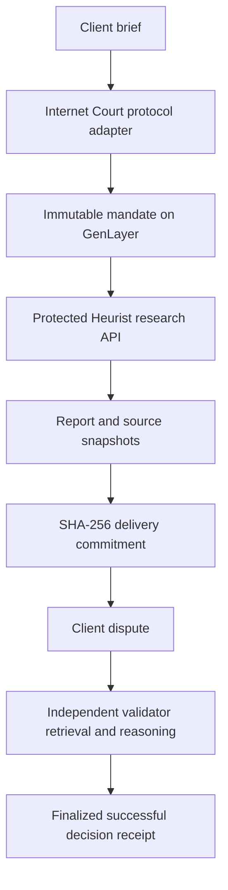

# Architecture

## Undeployed structured assessment candidate — 13 November 2026

`contracts/proof_pilot_v3.py` is a single offline replacement candidate. Models produce nine criterion/state/reference rows; source quotations, outcome and bounded explanation are derived deterministically. Validators retrieve and hash sources independently, make a blind assessment, then verify citation relevance. Prior versions/tasks/evidence remain preserved. No new deployment, blockchain write, funding, Heurist request, Git push or Vercel release has occurred. [Engineering review](evidence/structured-candidate-2026-11-13/REVIEW.md), [reproduction guide](REPRODUCE.md) and [bounded execution plan](FINAL_EXECUTION_PLAN.md). Production is still the historical deployment; this local change is not live. Browser CI and genuine network consensus remain unverified.

The browser owns editable drafts, evidence export and transaction display. The backend owns protected paid API access. GenLayer owns immutable assignments, submissions, dispute authorization and independently validated decisions. External pinned documents supply source bytes; their truth is not guaranteed by a hash.



## State machine

`AGREED -> DELIVERED -> DISPUTED -> DECIDED`. Only the commissioning sender can advance a task. There is no edit, second delivery, duplicate dispute or second settlement method. Protocol-level appeals remain a network feature; ProofPilot does not implement a separate internal appeal round.

## Internet Court adapter

Reference: `internet-court/internet-court-skill` at `462bf30efaea73c8af4ed9d6e9970d4495224ad2`, especially `integrations/genlayer-intelligent-contracts/SKILL.md`.

This is a custom, disclosed adaptation of the documented `AgentPerformanceReviewInput` and `AgentReviewDecision` concepts. Objective and rubric are mandate fields. The evidence commitment is the reviewed action ID. Outputs are the exact report and pinned source manifest. The dispute window is a lifecycle condition: after delivery and before the one terminal adjudication. There is no time-limited expiry requirement or funds to escrow. Decisions map `ACCEPTED -> continue`, `REJECTED -> warn`, `INCONCLUSIVE -> escalate`. No authority is constrained or revoked and no reputation registry is updated.

## Heurist adapter

Reference: `heurist-network/heurist-mesh-skill` at `f116a8423010e06f500b89c94d490ed79ad12945`.

`GET https://mesh.heurist.xyz/mesh_schema?agent_id=ExaSearchDigestAgent`, then `POST https://mesh.heurist.xyz/mesh_request` with bearer authentication and body:

```json
{"agent_id":"ExaSearchDigestAgent","input":{"tool":"exa_web_search","tool_arguments":{"query":"<locked objective>"}}}
```

The adapter verifies that the published schema exposes `query` without additional required parameters. A schema change fails explicitly. It records raw response SHA-256, schema hash, provider request ID where returned, request input and receive time. A real key is required before any request. There is exactly one execution attempt; uncertain paid requests are never retried. Operator access is timing-safe token protected. Each HTTP call has an 18-second timeout and a 64 KB streamed response limit.

## GenLayer consensus

A bundle embeds the exact report bytes (canonical JSON), plus up to three commit-pinned raw GitHub documents and expected SHA-256 values. Each node independently retrieves those documents and checks status, byte size and digest before reasoning. Unknown or unavailable support produces INCONCLUSIVE. A well-formed grounded LLM decision requires per-criterion labels and exact source quotations. The validator independently executes the task, verifies the leader quotations against independently retrieved bytes, and compares **all criterion states and the resulting outcome**. It does not merely accept permitted JSON labels. Invalid model output gets at most two local attempts and then fails; the network may rotate, bounded to two rotations in the client.

The task decision hash commits to the mandate/evidence hashes and receipt. Four append-only audit records per task link previous hashes and state hashes. Transaction IDs are external protocol evidence rather than caller-supplied self-assertions. The receipt records outcome and review decision; only the client UI adds finalized transaction evidence.

Canonical serialization sorts object keys, uses compact separators and ASCII JSON escaping. User-entered task criteria and reports are bounded plain English. UTF-8 source bytes are hashed before decoding. Do not hash a reformatted source file.
