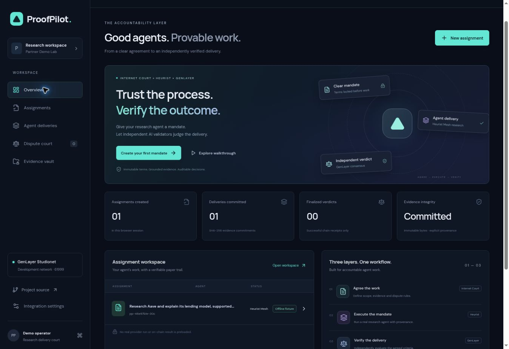

# ProofPilot — AI Agent Delivery Court

## Latest corrected-contract result — 13 November 2026

The four authorized transactions were each submitted once. Mandate, authentic delivery and dispute finalized SUCCESS; the single corrected adjudication finalized execution ERROR. Task pp-corrected-18ec1e64ccb747d8 remains DISPUTED with no verdict/decision hash. All blockchain writes stopped. [Current receipts, diagnostics and remaining limitation](evidence/corrected-lifecycle-2026-11-13/README.md). The deployed source and original research are unchanged; no new Heurist call or deployment occurred. Production transaction configuration remains V1 because corrected-contract activation required successful adjudication. The public read-only archive now shows the actual corrected-contract failure. Earlier preparation and V2 records below are historical.

## Corrected contract deployed — lifecycle pending approval

The approved prompt-clarification candidate deployed once, FINALIZED / SUCCESS, at [0xdcDdcB1C570700Da7C3d6c98E9FCC23801608373](https://explorer-studio.genlayer.com/address/0xdcDdcB1C570700Da7C3d6c98E9FCC23801608373). [Deployment receipt](https://explorer-studio.genlayer.com/transactions/0x38da8445e7503ce1c0d04556a24edb4df0f9d11d48433943448a2add906ad1f7), exact approved source hash and empty finalized state verified. No lifecycle transaction or new Heurist request was sent. All 87 existing tests passed before deployment. [Exact four-transaction approval plan](evidence/correction-deployment-2026-11-13/migration-plan.json) and [verification/preparation](evidence/correction-deployment-2026-11-13/README.md). Production contract configuration remains unchanged; future activation is prepared only. Prior V1/V2 failures and evidence are preserved. Mission remains incomplete until genuine successful adjudication.

Agree the work. Verify the delivery.

**Live website:** https://proofpilot-anza0x.vercel.app/



ProofPilot implements a research-delivery workflow around immutable mandates, a protected Heurist Mesh research adapter and an original GenLayer Intelligent Contract. The dark React interface guides the operator through assignment, agreement, execution, evidence commitment, dispute and finalized receipt.

## Honest integration status

- **Internet Court:** explicitly identified protocol adapter, based on its agent-performance review connector. Uses an agreed objective/rubric, committed action receipts, a dispute condition and a review decision. There is no invented Internet Court filing endpoint, escrow or delegation.
- **Heurist:** real server-side `/mesh_schema` and `/mesh_request` adapter for `ExaSearchDigestAgent.exa_web_search`, with payment credentials, schema checking and bounded responses. Live operation requires a configured API key and operator token. Offline fixtures are labeled; they are not provider results.
- **GenLayer:** V1 `contracts/proof_pilot.py` is preserved. Diagnostic V2 `contracts/proof_pilot_v2.py` is deployed at `0x8d64250Eb8c3Eafb8628482d2381799189055a90`, Stable Studionet 61999. Production transaction configuration remains V1 because the authorized switch was conditional on successful V2 adjudication; the website shows V2 evidence in a separate read-only archive.
- **Website:** configured exclusively for Vercel. No alternative hosting is authorized.
- **Mission readiness:** genuine funded Heurist research is preserved. V2 mandate, exact delivery and dispute finalized SUCCESS; V2 adjudication finalized with execution ERROR. No valid verdict exists. The mission is not submission-ready. See [current evidence](evidence/v2-lifecycle-2026-11-13/README.md).

## Run

```sh
npm ci
npm run dev -- --host 127.0.0.1
npm test
npm run test:contract
npm run lint
npm run typecheck
npm run build
```

Use `npx vercel dev` for the serverless API locally; plain Vite serves the interface and proxies `/api` to port 3000. Configure the server through `.env.example`. Never place the Heurist key in a `VITE_` variable.

## Workflow

1. Create a brief with required facts, acceptance criteria, source count and delivery conditions.
2. Lock its canonical SHA-256 commitment before execution.
3. Execute Heurist research using the protected server endpoint, or select the explicitly labeled offline walkthrough.
4. Export the raw provider receipt. Archive original source snapshots to a public Git commit. Prepare the pinned source manifest.
5. Commit the exact report, provenance and source hashes. The original criteria and delivery cannot change.
6. The commissioning account opens a single dispute.
7. GenLayer independently fetches and hashes each source, evaluates all acceptance criteria, and compares leader/validator decisions.
8. Show a verdict only after the transaction is finalized **and execution succeeded**, then export its receipt.

See [ARCHITECTURE.md](ARCHITECTURE.md), [SETUP.md](SETUP.md), [DEPLOYMENT.md](DEPLOYMENT.md), [SECURITY.md](SECURITY.md), [EVIDENCE.md](EVIDENCE.md), [DEMO.md](DEMO.md) and [SUBMISSION.md](SUBMISSION.md).

## Review boundaries

The contract proves adherence to agreed evidence and consensus logic, not the truth of an untrusted source or a provider identity. An operator-provided Heurist receipt is not a cryptographic provider attestation. The demo transfers no funds. Its protocol-adapter outcome is advisory; it does not create a legally binding court ruling.

## Current verified lifecycle

| Method | Verified result | Transaction |
| --- | --- | --- |
| create_assignment | FINALIZED / SUCCESS | [Explorer](https://explorer-studio.genlayer.com/transactions/0x209d8e8e899b1f68ab896698969666573e0e68e50a217c11fb804153b29823ad) |
| submit_delivery | FINALIZED / SUCCESS | [Explorer](https://explorer-studio.genlayer.com/transactions/0xfa6672091cdb93481e4505dca8da5bdf511c4f6078d0f5b2397f51d2603c62e4) |
| open_dispute | FINALIZED / SUCCESS | [Explorer](https://explorer-studio.genlayer.com/transactions/0x33edab7de57f447890e7eaaf768be556b056a098f8a479db038b4e68278178cb) |
| adjudicate | FINALIZED / ERROR | [Explorer](https://explorer-studio.genlayer.com/transactions/0xf70976a7d9effddb50ad4bd208c6c98b7ea39939a77a3eb22767177e57ad6dd9) |

The [87 automated tests](.github/workflows/ci.yml) cover frontend/domain/adapter logic and mocked contract execution. They do not substitute for real consensus. The genuine research predates the disclosed V2 mandate; no new Heurist execution is claimed. [V2 contract explorer](https://explorer-studio.genlayer.com/address/0x8d64250Eb8c3Eafb8628482d2381799189055a90) · [Preserved V1](https://explorer-studio.genlayer.com/address/0x95e28B38a3268f9e625e766B3FD6Cd0aa9f5430f).
